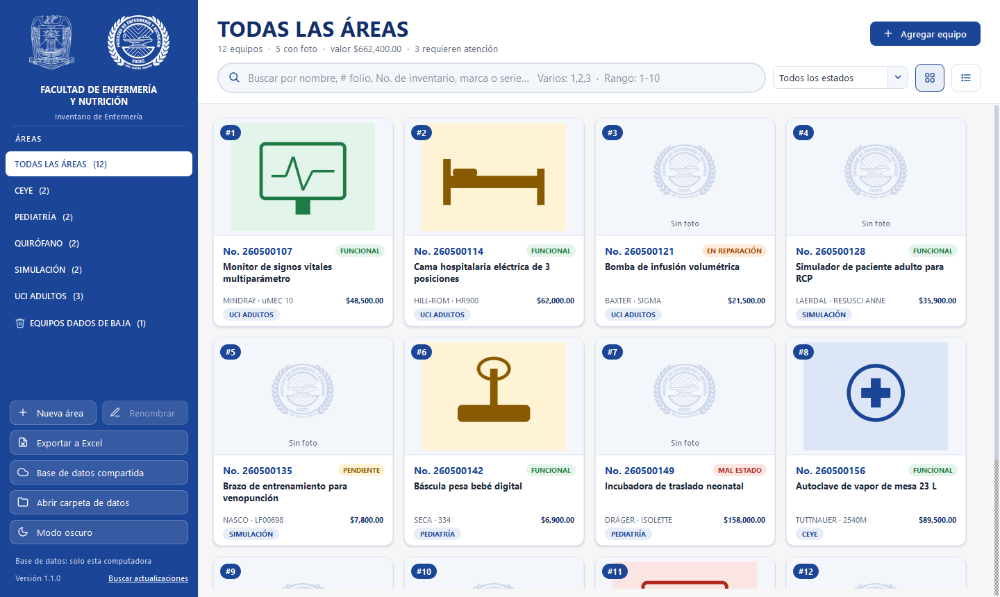
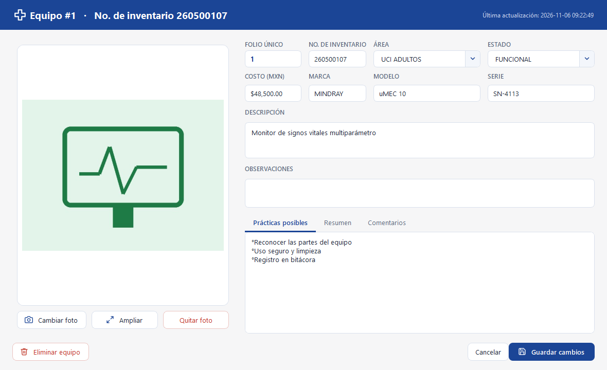
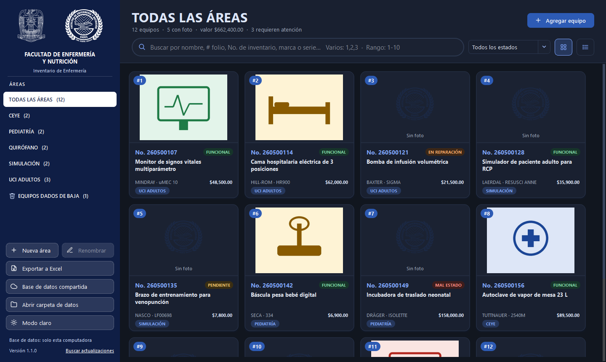
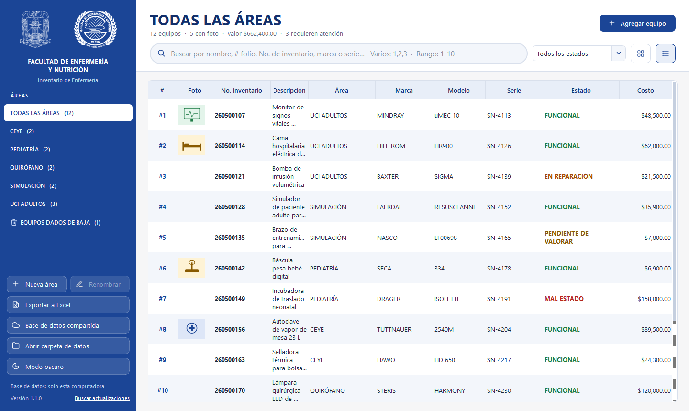
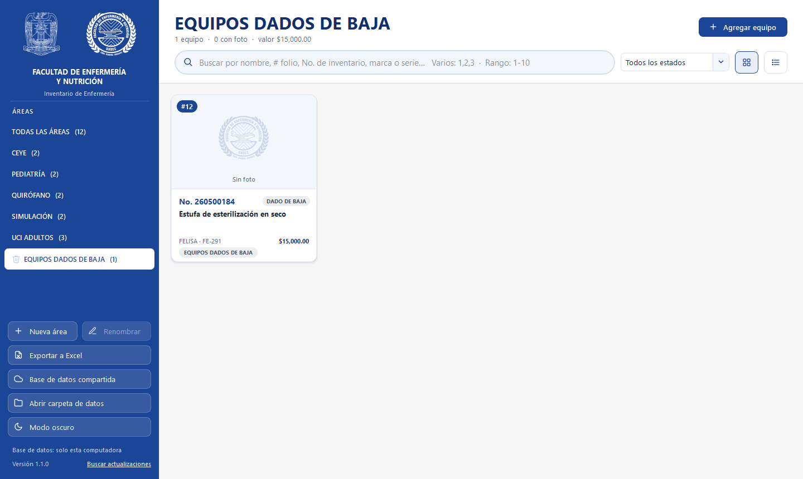

<div align="center">

<picture>
  <source media="(prefers-color-scheme: dark)" srcset="app/recursos/logo_horizontal_blanco.png">
  
</picture>

# Inventario de Enfermería

**Control del equipo de laboratorios y áreas clínicas de la Facultad de Enfermería y Nutrición (FAENUS · UAdeC).**
Fotos, estados, costos y exportación a Excel. El inventario se pasa entre computadoras con un solo archivo.

<br>

<a href="https://github.com/Shifu17/InventarioEnfermeria/releases/latest/download/InventarioEnfermeria.exe">
  
</a>

<br><br>

[](https://github.com/Shifu17/InventarioEnfermeria/releases/latest)
[](https://github.com/Shifu17/InventarioEnfermeria/releases)


<sub>Un solo archivo · No necesita instalación · Se actualiza solo</sub>

</div>

<br>

<p align="center">
  
</p>

---

## 📥 Cómo instalarlo

1. Da clic en **[Descargar para Windows](https://github.com/Shifu17/InventarioEnfermeria/releases/latest/download/InventarioEnfermeria.exe)**.
2. Mueve el archivo `InventarioEnfermeria.exe` a una carpeta tuya, por ejemplo **Documentos** o el **Escritorio**.
3. Ábrelo con doble clic.
4. Para traer el inventario de otra computadora: allá da clic en **Exportar BD** y aquí en **Importar BD**.

> [!NOTE]
> Si Windows muestra *“Windows protegió su PC”*, da clic en **Más información → Ejecutar de todas formas**.
> Aparece porque el programa no tiene firma digital comercial; es seguro.

> [!TIP]
> **¿Ya tenías una versión anterior?** Descarga esta una vez y reemplaza tu `.exe` viejo.
> A partir de la 1.1.0 el programa **se actualiza solo**: al abrirlo te avisa si hay una versión nueva.
> Las computadoras con la versión 1.1.0 o 1.2.0 reciben la versión nueva automáticamente.

---

## ✨ Qué puedes hacer

| | |
|---|---|
| 🔎 **Buscar al instante** | Por nombre, folio, No. de inventario, marca o serie. Varios folios (`1,2,3`) o rangos (`1-10`). |
| 🗂️ **Organizar por áreas** | Crea áreas, cámbiales el nombre (doble clic o clic derecho) o únelas. |
| 📷 **Fotos de cada equipo** | Arrastra una imagen a la ficha; clic para verla en grande. |
| 💲 **Costos** | Costo por equipo, valor total por área y suma en el Excel. |
| 🗑️ **Equipos dados de baja** | Se mueven solos a su propia área y regresan si se reactivan. |
| 💾 **Exportar / importar la base** | Todo el inventario con fotos en un solo `.zip` para pasarlo a otra computadora o guardarlo como respaldo. |
| 📊 **Exportar a Excel** | Una hoja por área, con fotos, costos y totales. |
| 🌙 **Modo oscuro** | Cámbialo con un botón; cada computadora recuerda su preferencia. |
| ⬆️ **Actualizaciones automáticas** | El programa avisa cuando hay una versión nueva y se actualiza con un clic. |

---

## 🖼️ Capturas

<table>
  <tr>
    <td width="50%"><p align="center"><sub>Ficha del equipo con foto, estado y costo</sub></p></td>
    <td width="50%"><p align="center"><sub>Modo oscuro</sub></p></td>
  </tr>
  <tr>
    <td width="50%"><p align="center"><sub>Vista de tabla con costos</sub></p></td>
    <td width="50%"><p align="center"><sub>Área automática de equipos dados de baja</sub></p></td>
  </tr>
</table>

<sub>Las capturas usan datos de ejemplo.</sub>

---

## ❓ Preguntas frecuentes

<details>
<summary><b>¿Cómo paso el inventario a otra computadora?</b></summary>

1. En la computadora que tiene el inventario da clic en **Exportar BD**: se crea un archivo `.zip` con la base de datos y todas las fotos.
2. Copia ese archivo a la otra computadora (USB, correo, Google Drive…).
3. En la otra computadora da clic en **Importar BD** y elige el archivo.

Importar reemplaza el inventario de esa computadora, pero antes guarda automáticamente una copia del anterior.
</details>

<details>
<summary><b>¿Se pierden mis datos al actualizar?</b></summary>

No. Al actualizar solo se reemplaza el archivo `.exe`; el inventario y las fotos están en otra carpeta y no se tocan.
Además se guarda una copia del programa anterior como `InventarioEnfermeria.exe.anterior`.
</details>

<details>
<summary><b>¿Dónde están mis datos y cómo hago un respaldo?</b></summary>

Da clic en **Exportar BD**: el archivo `.zip` que se crea es un respaldo completo (base de datos y fotos).
Guárdalo de vez en cuando en una memoria USB o en la nube. **Abrir carpeta de datos** muestra dónde vive el inventario
en esa computadora.
</details>

<details>
<summary><b>¿Dónde se guardan los datos? ¿Están en este repositorio?</b></summary>

No. Este repositorio público solo contiene el programa. El inventario y las fotos se guardan únicamente en cada
computadora; el programa no los envía a ningún servidor. Solo se conecta a GitHub para revisar si hay una versión nueva.
</details>

---

<details>
<summary><b>🛠️ Para desarrolladores</b></summary>

Hecho con Python 3.12 y PySide6 (Qt).

```bat
:: Ejecutar desde el código (crea el entorno la primera vez)
"Iniciar Inventario.bat"

:: Pruebas
.venv\Scripts\python -m pytest

:: Compilar el .exe  ->  dist\InventarioEnfermeria.exe
"Crear EXE.bat"
```

**Publicar una versión nueva** (los programas instalados la reciben solos):

1. Cambia `VERSION` en `app/version.py` y describe los cambios en `NOTAS_VERSION.md`.
2. `git commit -am "Versión X.Y.Z"` → `git tag vX.Y.Z` → `git push --follow-tags`
3. GitHub Actions prueba, compila y publica el `.exe` en *Releases*.
   Si Actions no está disponible, compila con `Crear EXE.bat` y publica con
   `gh release create vX.Y.Z dist/InventarioEnfermeria.exe --notes-file NOTAS_VERSION.md`.

| Carpeta | Contenido |
|---|---|
| `app/` | Interfaz (`ventana.py`, `ficha.py`), datos (`db.py`), exportar/importar (`respaldo.py`), actualizador, estilos |
| `tests/` | Pruebas automáticas |
| `herramientas/` | Importación inicial desde Excel |
</details>

<div align="center">
<sub>Facultad de Enfermería y Nutrición · Universidad Autónoma de Coahuila</sub>
</div>
